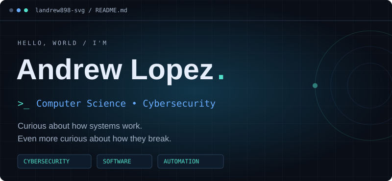
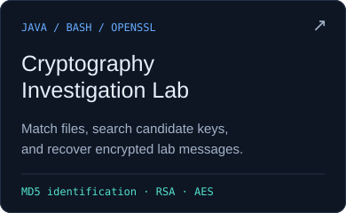
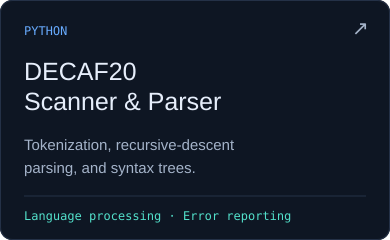
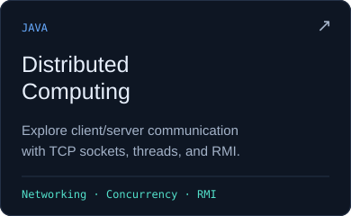
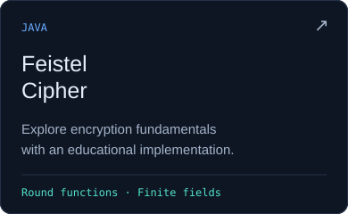
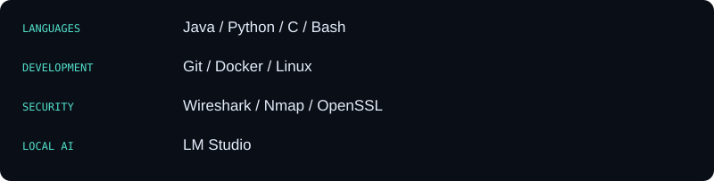
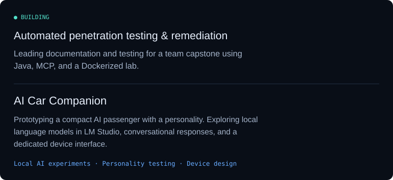
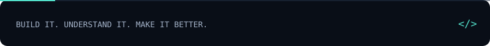

<!-- Profile graphics are stored alongside this README. -->

  

## 01 / Selected work

<table>
  <tr>
    <td width="50%"></td>
    <td width="50%"></td>
  </tr>
  <tr>
    <td width="50%"></td>
    <td width="50%"></td>
  </tr>
</table>

## 02 / The toolkit

## 03 / In progress

